# Pixelboard

A live MLB, NFL, NBA and NHL scoreboard for your wall, built from a Raspberry Pi and two
LED panels. When the games are over it turns into an arcade.

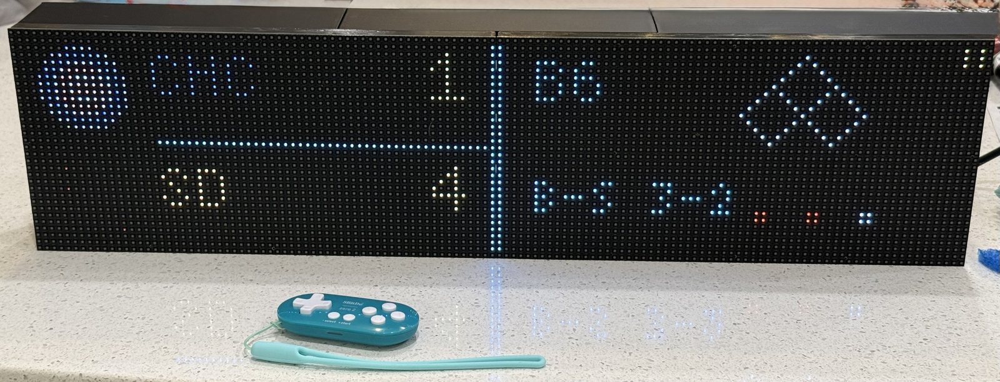

Pixelboard drives a 128×32 RGB LED matrix (two chained 64×32 HUB75 panels,
about 20 × 5 inches). It follows your teams through the day, celebrates when
they score, goes dim at bedtime, and has seven games you play with a small
Bluetooth controller. You run and set it up from any phone on your home Wi-Fi.
There's no app to install and no cloud account.

## Sports selection (0.9.0)

Choose MLB, NFL, NBA and NHL independently, then select all teams or only the
teams you follow. Use Select → Sports on the remote, or the dashboard’s
**Sports & teams in rotation** controls. [Sports and recovery guide](docs/SPORTS.md).

## Why I built it

We wanted an MLB scoreboard for our son for his birthday, but the ones I found
online were expensive and limited in what they could show or do. I figured I
could build one myself. Once I saw what was possible, I kept adding features
and got excited about what it was becoming. I’m sharing Pixelboard so other
families can build their own and adapt it to their household.

Pixelboard is designed for personal use in one household and needs an internet
connection for live scores. It gets MLB data from MLB Stats API and NFL, NBA and NHL scores
from ESPN’s scoreboard feeds. These feeds depend on their providers’ availability
and terms. You can also add an iCalendar subscription for a youth team. If a
GameChanger team provides a feed, Pixelboard can show its games and practices
alongside the other scores. Keep calendar subscription URLs private.

## What it shows

| | |
|---|---|
| 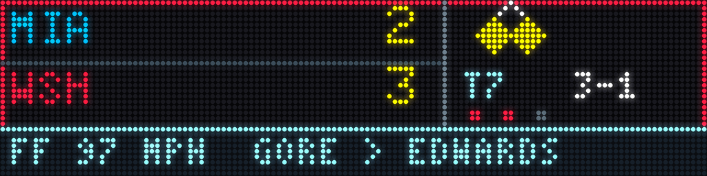 | **Live baseball**: score, inning, count, outs, runners on base, the last pitch's type and speed, and pitcher vs. batter |
| 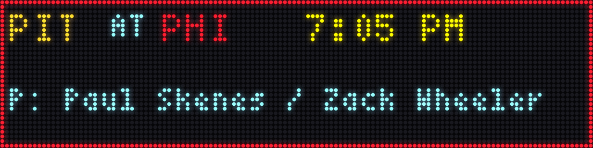 | **Pregame**: start time and probable starting pitchers |
| 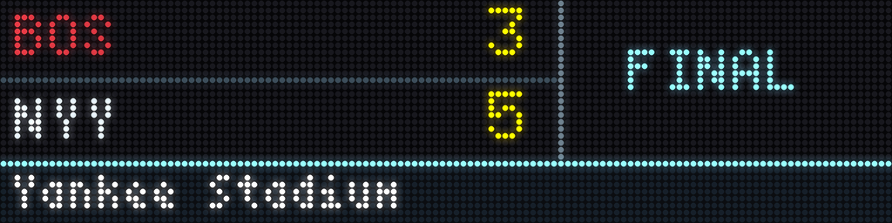 | **Finals** with the ballpark |
| 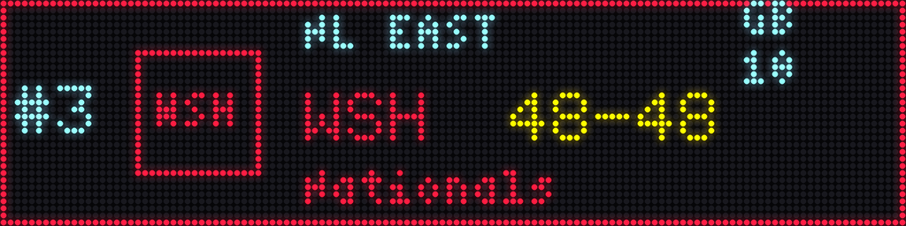 | **Division standings** for your favorite teams |
| 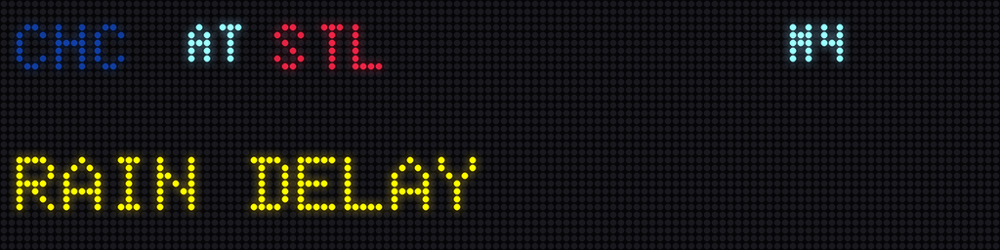 | **Delays and postponements** |
| 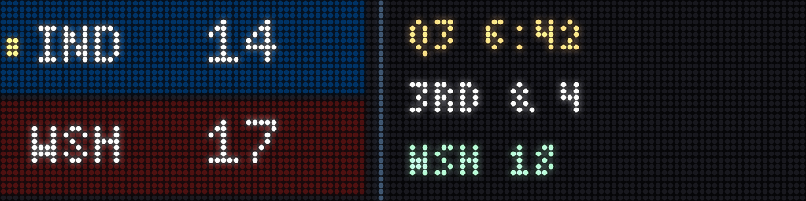 | **Live football**: score, quarter and clock, down and distance, and possession |
| 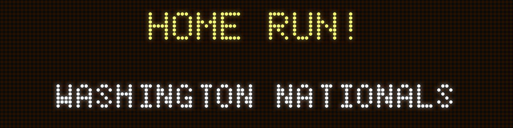 | **Scoring alerts**: a full-screen HOME RUN or TOUCHDOWN when a team in the game on screen scores |
| 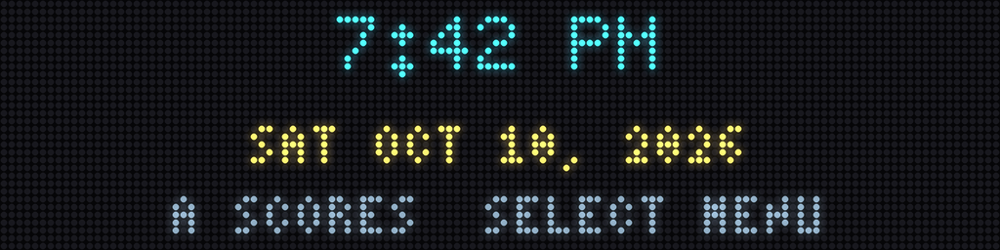 | **Home clock** with the date, one button away |

It also has:

- **Basketball and hockey** scores, quarters/periods, overtime and shootouts
- **Sport and team filters** to keep the rotation focused
- **Past scores** for any date, following your saved sport/team choices
- **A morning recap** of last night's results and today's games
- **An optional team-schedule card** for a kids' or local team, read from any
  iCalendar link, with games, practices and a record you keep up to date
- **Announcements** you type on your phone, with an optional fireworks finale

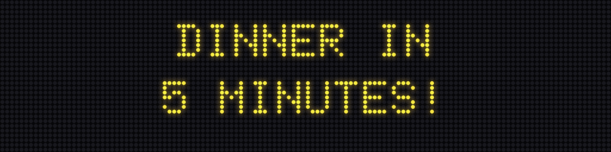
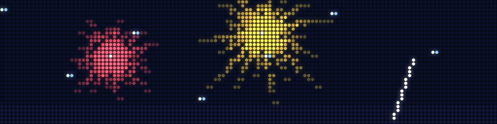

### Quiet hours

On a schedule you set, the board either **dims way down** and keeps showing
scores, or **goes dark**. During quiet hours any button on the controller
wakes it for a minute (you can change how long), and the arcade stays closed
until morning.

## The arcade

Press Select on the controller and pick **Arcade Games**. Every game is drawn
for the 128×32 panel and plays with the 8BitDo Zero 2's D-pad and buttons.

| | |
|---|---|
| 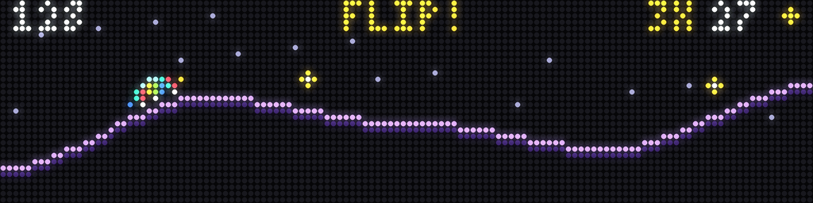 | **Neon Rider**: hold A to drive over neon hills; keep holding in the air to backflip, and land it for bonus gems |
| 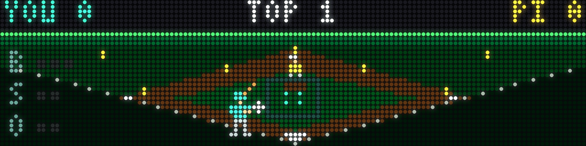 | **Big League**: three innings of real baseball against the Pi. Aim and time your swing, pick your pitches, and send your runners |
| 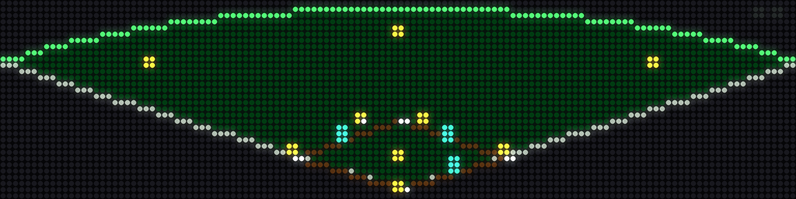 | Once the ball is hit, Big League switches to a view of the whole field, with fielders chasing it down and throwing to bases |
| 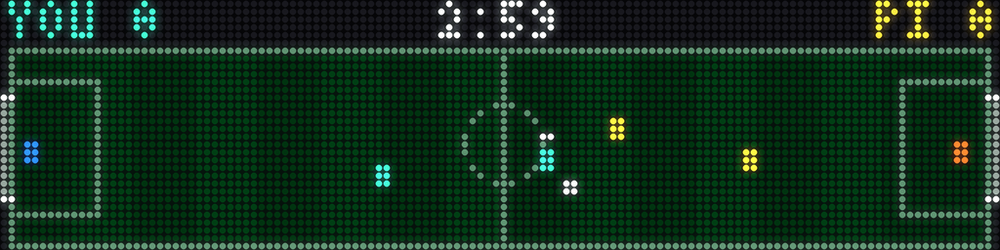 | **Soccer**: 3-on-3 against the Pi, with passes, shots to the corners, dash tackles and a golden goal |
| 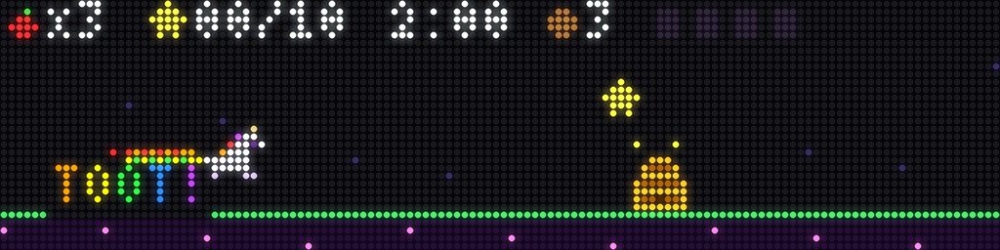 | **Rainbow Toot Unicorn**: a galloping unicorn that toots rainbows to fly, collects stars, bombs beehives, and stops to dance the SIX SEVEN |
| 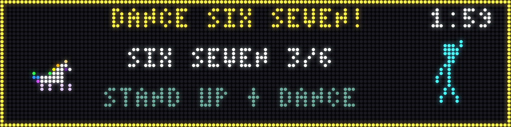 | Exactly what it sounds like |

There are also **Baseball** (a quick batting game), **Snake** and **Pong**.

Neon Rider, Big League, Soccer and the unicorn fill **one shared gem jar** for
the household, which you can also top up from the admin panel. You spend gems
in the **Style Shop** on new cars, colors and tracks for Neon Rider. Every three
hours there's a 10-minute **Happy Hour** with triple gems. There are no player
names or profiles, just one high score per game. See [the arcade guide](docs/ARCADE.md).

## The admin panel

Open `http://pixelboard.local:8123/` on any phone or computer on the same
Wi-Fi. Anything that changes the board needs a six-digit household PIN.

| | | |
|---|---|---|
| 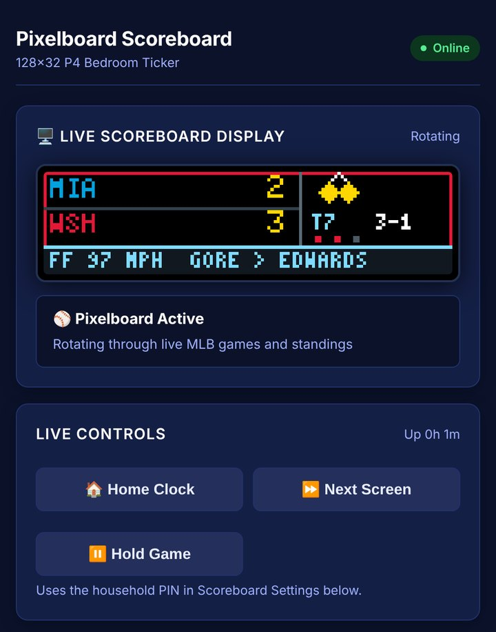 | 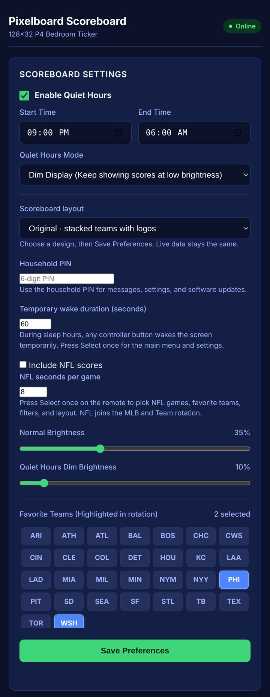 | 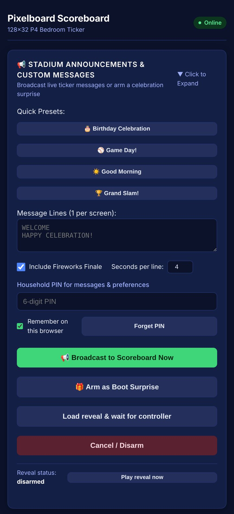 |
| A pixel-accurate **live preview** of the panel, plus Home, Next and Hold buttons | **Settings**: sports, selected teams, favorites, brightness, quiet hours and layout | **Announcements** with presets and fireworks, plus a surprise you can arm to play on the next boot |

The panel also covers past scores, the team schedule, arcade gems and high
scores, and **one-tap software updates**. Updates are staged and checked
before they go live, and roll back automatically if the new version doesn't
come up healthy.

## The real thing

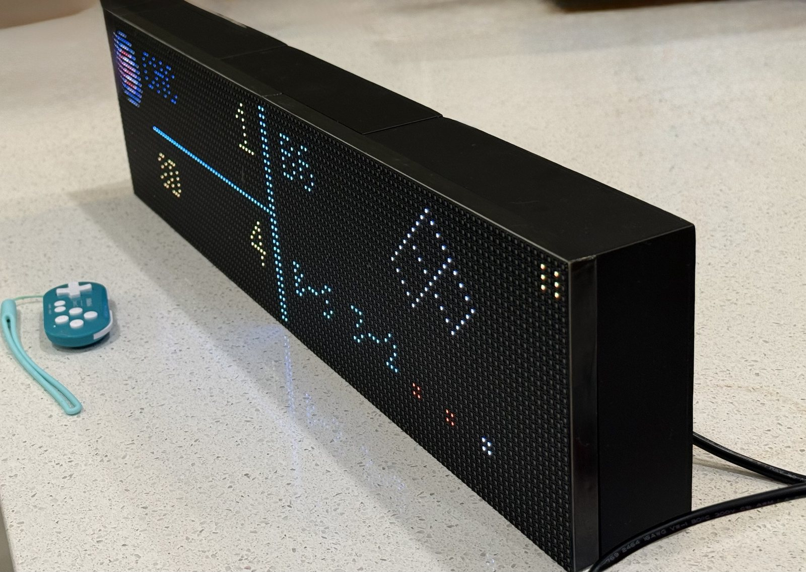
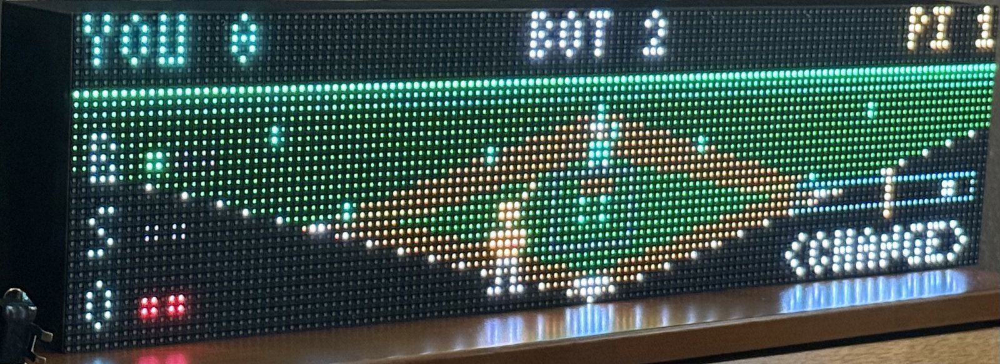
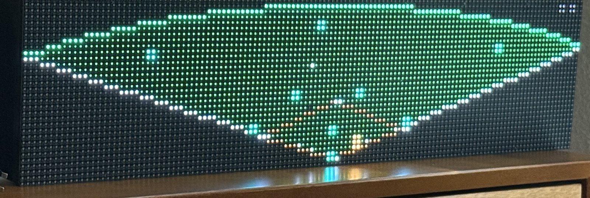
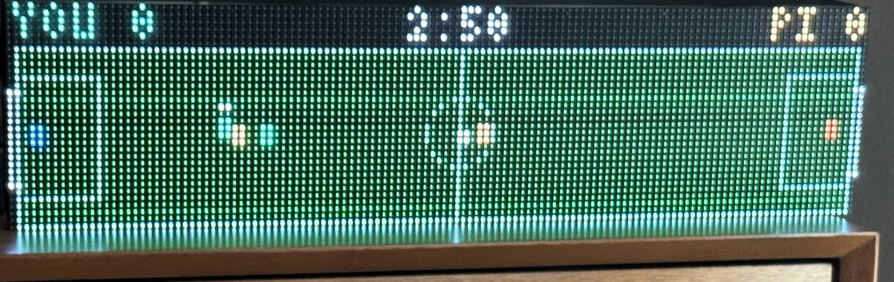
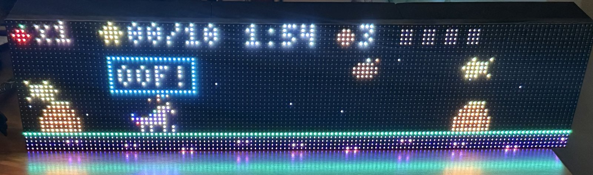
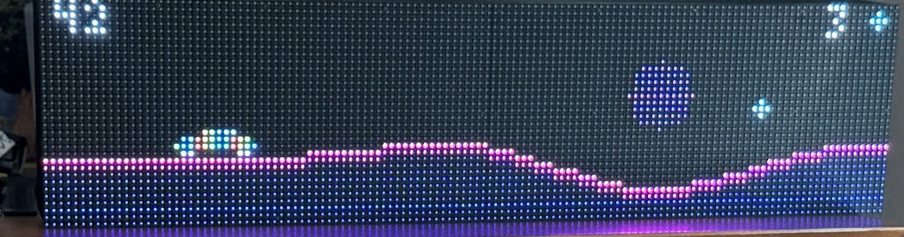

## Build your own

You'll need:

| Part | Notes |
| --- | --- |
| 2 × 64×32 P4 HUB75 RGB LED panels | Chained to make 128×32 (Adafruit 2278 or similar) |
| Raspberry Pi 3 Model A+ | Other Pis supported by `rpi-rgb-led-matrix` should work but are untested |
| Adafruit RGB Matrix Bonnet or HAT | Connects the Pi to the panels |
| 5 V 10 A power supply for the panels | Keep it separate from the Pi's power |
| 5 V 2.5 A supply for the Pi | not needed for the final display because it can get power through the hat, but hopeful when setting up the raspberry pi before connecting it |
| 8BitDo Zero 2 controller | Paired over Bluetooth in keyboard mode |
| microSD card | A high-endurance card is a good idea |

The full parts list is in the [bill of materials](targets/linux-sbc-hub75/package/PILOT-BOM.md),
and there's a 3D-printable rear enclosure in [hardware/](hardware/README.md).

Then:

1. **Try it in your browser first.** The studio runs the same renderer as the
   device, with demo data:

   ```bash
   npm ci
   python3 -m venv .venv
   .venv/bin/pip install -r requirements.lock.txt
   npm run dev
   ```

2. **Generate a device package** from the studio's Setup view and install it on
   a Pi running Raspberry Pi OS Lite. The [installation guide](targets/linux-sbc-hub75/package/README-INSTALL.md)
   covers the installer, the household PIN and dashboard updates. The
   [assembly guide](targets/linux-sbc-hub75/package/ASSEMBLY-GUIDE.md) shows
   how the hardware fits together.
3. **Pair the controller.** See [controls](docs/CONTROLS.md).
4. **Tune the panel** if it flickers. [Pi tips](docs/PI_TIPS.md) collects
   everything learned getting a steady picture on a Pi 3 A+.

No team logos are included. Pixelboard shows team colors and abbreviations
instead, which is what the panel screenshots on this page use. If you have
permission to use logo images, see [the logo folder notes](frontend/public/private-assets/team-logos/README.md).

## How it works

- **The device runtime** (`targets/linux-sbc-hub75/runtime/`) is a Python
  service on the Pi. It polls live game data, renders frames, drives the panel
  through [hzeller/rpi-rgb-led-matrix](https://github.com/hzeller/rpi-rgb-led-matrix),
  reads the Bluetooth controller, and serves the admin panel on port 8123.
- **The studio** (`frontend/`, `backend/`) is a React and TypeScript app for
  previewing every screen, designing layouts and building device packages.
- **Pixel-for-pixel parity**: the Python renderer (`shared_py/`) and the
  TypeScript renderer (`shared_ts/`) must produce byte-identical frames. Both
  test suites check hundreds of reference frames by SHA-256, and the Pi
  re-checks them within a 50 ms-per-frame budget before every install. Arcade
  games use only integer maths for the same reason; see
  [adding a game](docs/ARCADE.md#adding-a-game).
- **Claude Code ready**: `CLAUDE.md` and `.claude/skills/` describe the
  project's rules, so you can open the repository in
  [Claude Code](https://claude.com/claude-code) and ask it to build a new arcade
  game. It will follow the file map, the parity rules and the fixture tooling.

## Develop and verify

```bash
npm test          # TypeScript tests
npm run test:py   # Python tests
npm run build     # typecheck and production build
```

See [contributing](CONTRIBUTING.md) and the [roadmap](docs/ROADMAP.md).

## Project status

Pixelboard is a hobby project that runs every day on one wall. It works well
on the hardware above but hasn't been tried on much else yet. Issues and pull
requests are welcome.

The project is an unofficial fan project. It is not affiliated with MLB, the
NFL, NBA, NHL, their teams, or data providers. Team names and logos are owned by their
respective rights holders. Live feeds depend on external services, and their
terms apply to your use of them.

## Project licenses

- Software: [MIT](LICENSE)
- Original hardware designs: [CERN-OHL-S-2.0](hardware/LICENSE)
- Original documentation and project images: [CC BY 4.0](docs/LICENSE)

Third-party code, fonts, data, and marks retain their own notices and terms;
see [third-party notices](targets/linux-sbc-hub75/package/THIRD_PARTY_NOTICES.md).
